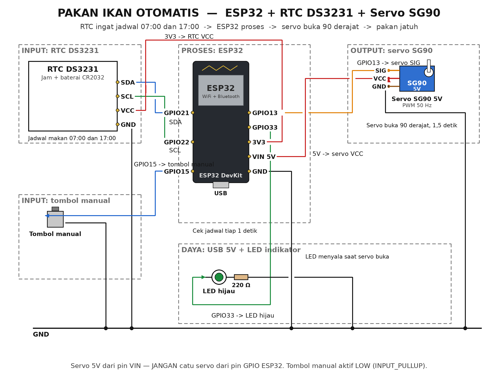

# Pakan Ikan Otomatis — ESP32 + RTC DS3231 + Servo SG90

Ikan di akuarium diberi makan otomatis dua kali sehari, pagi dan sore,
tanpa pemilik harus ada di rumah. Jam RTC DS3231 menyimpan jadwal dan
tetap berjalan walau ESP32 sempat mati (baterai CR2032 di modul RTC).
Begitu waktu makan tiba, servo SG90 memiringkan wadah pakan sebentar
supaya pakan jatuh secukupnya ke akuarium, lalu wadah kembali menutup.
Tombol manual memberi makan sekali di luar jadwal, dan LED hijau menyala
selama servo membuka wadah.

Video penjelasan (60 detik): https://www.youtube.com/shorts/keTsFkHhw7Q

## Yang dipakai

- ESP32 DevKit (WiFi + Bluetooth)
- RTC DS3231 + baterai CR2032 (jam real-time, I2C)
- Servo SG90 5V (PWM 50 Hz)
- Tombol push button (manual, aktif LOW)
- LED hijau + resistor 220 ohm
- Wadah pakan + pelet ikan
- Kabel jumper, breadboard atau PCB

## Wiring

| Dari | Ke | Keterangan |
| --- | --- | --- |
| RTC SDA | GPIO21 | Data I2C |
| RTC SCL | GPIO22 | Clock I2C |
| RTC VCC | 3V3 | Catu 3,3V |
| RTC GND | GND | Ground bersama |
| Servo SIG (oranye) | GPIO13 | Sinyal PWM 50 Hz |
| Servo VCC (merah) | 5V (VIN) | Catu servo dari pin VIN |
| Servo GND (coklat) | GND | Ground bersama |
| Tombol kaki 1 | GPIO15 | INPUT_PULLUP, aktif LOW |
| Tombol kaki 2 | GND | Ground bersama |
| LED hijau anoda | GPIO33 | Seri resistor 220 ohm |
| LED hijau katoda | GND | Ground bersama |
| ESP32 | USB 5V | Catu utama |

Perhatian: servo 5V dicatu dari pin VIN, arusnya lewat servo langsung —
jangan pernah mencatu servo dari pin GPIO ESP32. Tombol memakai
INPUT_PULLUP, jadi tidak butuh resistor luar.

## Cara kerja

Jam RTC dicek tiap 1 detik. Begitu jam menunjukkan 07:00 atau 17:00 dan
jadwal itu belum dijalankan di menit tersebut, servo membuka wadah ke
90 derajat selama 1,5 detik, pakan jatuh secukupnya, lalu servo kembali
ke 0 derajat dan wadah menutup. LED hijau menyala selama wadah terbuka.
Tekan tombol manual kapan saja untuk memberi makan sekali di luar jadwal.
Semua pencatatan (jumlah pemberian pakan, status, jam RTC) bisa dilihat
di Serial Monitor 115200 baud.

## Konfigurasi

Semua pengaturan ada di bagian atas sketch
`PakanIkanOtomatis/PakanIkanOtomatis.ino`:

- `PIN_SERVO = 13` — pin sinyal servo SG90
- `PIN_TOMBOL = 15` — pin tombol manual (INPUT_PULLUP)
- `PIN_LED = 33` — pin LED hijau
- `SUDUT_TUTUP = 0` — posisi servo saat wadah tertutup
- `SUDUT_BUKA = 90` — posisi servo saat wadah terbuka
- `WAKTU_BUKA_MS = 1500` — lama servo terbuka tiap pemberian pakan
- `INTERVAL_CEK_MS = 1000` — interval cek jadwal
- `JADWAL_MAKAN` — jadwal makan, default `{7, 0}` dan `{17, 0}`

Perintah Serial Monitor (115200 baud):

- ketik `m` lalu Enter — beri makan sekali (manual)
- ketik `s` lalu Enter — tampilkan status dan jadwal
- ketik `j` lalu Enter, lalu `YYYY-MM-DD HH:MM` — atur jam RTC

## Tips pemakaian

- Isi wadah pakan secukupnya dan pasang wadah di atas akuarium dengan
  lubang keluar menghadap ke air, supaya pakan jatuh langsung ke air.
- Pelet yang terlalu besar bisa menyangkut di lubang wadah — pakai pelet
  kecil atau hancurkan sedikit sebelum dimasukkan ke wadah.
- Atur jam RTC sekali lewat Serial Monitor setelah modul pertama kali
  dipasang; sesudah itu baterai CR2032 menjaga jam tetap jalan walau
  ESP32 dimatikan.
- Kalau ikan terlihat masih lapar di luar jadwal, tekan tombol manual
  sekali — jangan memberi makan berlebihan, sisa pakan mengotori air.

## Library yang dibutuhkan

| Library | Versi | Keterangan |
|---|---|---|
| RTClib | 2.1.4 | RTC DS3231 |
| ESP32Servo | 3.2.1 | Servo SG90 (WAJIB 3.2.x — 3.0.1 gagal compile di ESP32 core 4.x) |

Kedua library juga tersedia sebagai ZIP di folder
[`libraries/`](libraries/) — install lewat Arduino IDE:
Sketch → Include Library → Add .ZIP Library.

## Verifikasi compile

Sketch terverifikasi compile 22 Nov 2026 dengan arduino-cli 1.6.0,
ESP32 core 4.0.0:

- Sketch memakai 337.923 byte (25%) dari program storage (maksimum
  1.310.720 byte)
- Variabel global memakai 25.156 byte (7%) dari dynamic memory
  (maksimum 327.680 byte)

## Skema

## Lisensi

MIT — lihat file `LICENSE`.
